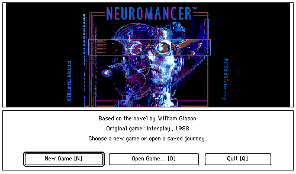
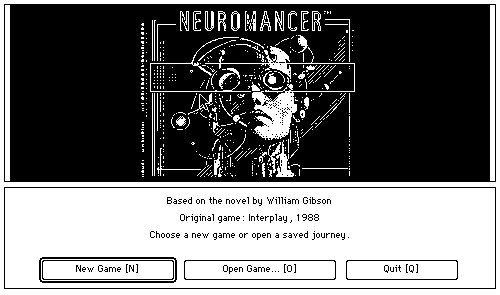
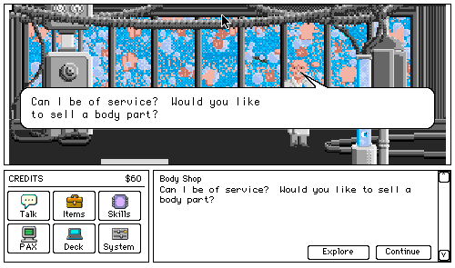
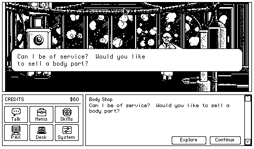
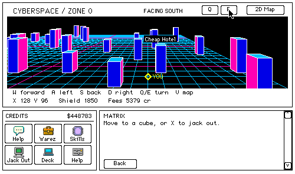
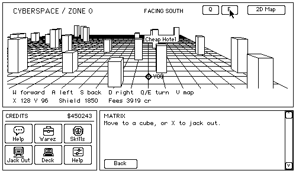
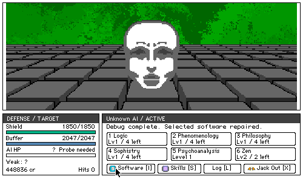
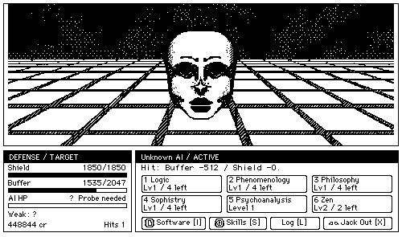

# Neuromancer for 68K Macintosh

 

**클래식 Mac에서 만나는 치바 시티.**

Apple IIGS판 *Neuromancer*를 기반으로 만든 68K Macintosh 네이티브 게임입니다. 도시를 탐색하고, 사람들과 대화하며 단서를 모으고, 데이터베이스에 접속하고, 사이버스페이스에서 ICE와 AI에 맞섭니다. 화면과 조작은 512 × 342의 클래식 Mac 환경에 맞췄습니다.

**v0.0.2 · 흑백판 & 컬러판**

[다운로드 / Releases](https://github.com/apple2forever/neuromancer-mac68k/releases) · [English](README.md) · [문제 제보](https://github.com/apple2forever/neuromancer-mac68k/issues)

| 컬러판 | 흑백판 |
| :---: | :---: |
|  |  |
| Apple IIGS 원작 컬러 그래픽 | 별도로 그린 1비트 흑백 그래픽 |

## 두 가지 모습으로 즐기는 같은 여정

- **컬러판:** Apple IIGS 원작의 장면을 Color QuickDraw로 표시합니다.
- **흑백판:** 검고 흰 면, 도트와 빗금을 사용해 별도로 그렸습니다. 컬러 이미지를 실행 중 단순 디더링한 화면이 아닙니다.
- **Mac다운 조작:** 누르면 반전되는 이미지 아이콘, 이동 방향 커서, 말풍선과 표준 파일 메뉴·대화상자를 사용합니다.
- **사이버스페이스:** 원근감 있는 3D 이동 화면과 2D 지도 전환, ICE·AI 전용 전투 인터페이스를 제공합니다.
- **진행 저장:** New Game, Open, Save, Save As를 지원하며, 저장하지 않은 진행을 버리기 전에 확인합니다.

Chatsubo에서 시작해 최종 전투와 엔딩까지 이어지는 경로가 구현되어 있습니다. 계속 다듬고 있으며, 버그나 원작과 다른 동작에 대한 제보를 환영합니다.

## 스크린샷

실제 에뮬레이터에서 촬영했습니다. 바탕화면과 창 테두리만 잘라내고 게임 내용은 원래 픽셀 크기로 유지했습니다. 이미지를 클릭하면 따로 볼 수 있습니다.

| | 컬러판 | 흑백판 |
| :--- | :---: | :---: |
| **대화** |  |  |
| **사이버스페이스** |  |  |
| **AI 전투** |  |  |

## 다운로드와 실행

디스크 이미지는 [GitHub Releases](https://github.com/apple2forever/neuromancer-mac68k/releases)에서 받습니다.

| 버전 | Release 첨부 파일 |
| :--- | :--- |
| 컬러판 | `Neuromancer-v0.0.2-Color.dsk` |
| 흑백판 | `Neuromancer-v0.0.2-Monochrome.dsk` |

1. Mac 또는 에뮬레이터를 기종에 맞는 System 6이나 System 7로 부팅합니다.
2. 원하는 버전의 DSK를 연결합니다. 두 이미지 모두 **게임 앱만 담은 1.44 MB HFS 설치 이미지**입니다.
3. 클래식 Mac의 Finder에서 앱을 하드디스크로 복사하고 **Neuromancer**를 실행합니다.
4. **New Game**으로 시작하거나 **Open Game…**으로 기존 저장을 엽니다. 진행은 쓰기 가능한 Mac 볼륨에 저장합니다.

**부팅용 디스크가 아닙니다.** Mac 시스템 소프트웨어·ROM·저장 파일은 포함하지 않습니다. 앱의 리소스 포크를 유지할 수 있도록 클래식 Mac의 Finder 안에서 복사하세요. 이미지 연결 방식은 에뮬레이터에 따라 다릅니다.

## 확인한 실행 환경

| 버전 | Mac / RAM | System | 에뮬레이터 |
| :--- | :--- | :--- | :--- |
| 흑백판 | Macintosh Plus / 4 MB | 6.0.8 | PCE |
| 컬러판 | Macintosh IIx / 8 MB | 6.0.8 | MAME |
| 컬러판 | Macintosh LC III / 8 MB | 7.1.1 | MAME |

위 표는 실제 검증 환경이며 모든 기종과 에뮬레이터의 호환을 보장하는 목록은 아닙니다. 컬러판은 **Color QuickDraw**가 필요합니다. 전체 화면 구성은 **512 × 342** 기준이며, 창 내부 게임 내용은 500 × 295입니다.

System 7 / MultiFinder에서는 앱 메모리를 **최소 1,536 KB / 권장 2,048 KB**로 유지하세요. 이는 앱에 할당하는 메모리이며 Mac 전체 RAM 용량과는 다릅니다.

## 주요 조작

| 동작 | 조작 |
| :--- | :--- |
| 도시 이동 | 이동 가능한 장면 가장자리에 마우스를 올리면 방향 커서가 나타납니다. 클릭하거나 `W A S D` / 방향키로 이동합니다. |
| 대화와 진행 | **Talk** 클릭 또는 `T`. 열린 말풍선 클릭이나 `Return`으로 진행합니다. 일부 NPC는 진입 시 자동으로 말을 시작합니다. |
| 대답 선택 | `Space`로 생각을 바꾸고 `Return`으로 말합니다. 숫자키로 바로 선택할 수도 있습니다. 선택 변경과 확정 때 짧은 효과음이 납니다. |
| 3D 사이버스페이스 | `W A S D`: 보는 방향 기준 앞/왼쪽/뒤/오른쪽. `Q / E`: 회전. `V`: 2D 지도 전환. |
| ICE·AI 전투 | 행동 버튼 클릭 또는 `1–6`으로 즉시 실행. `I`: 소프트웨어, `S`: 스킬, `L`: 전투 기록. |
| 저장·열기·종료 | `Command-S` / `Command-O` / `Command-Q`. 다른 이름으로 저장: `Shift-Command-S`. |
| 전체 도움말 | **Help → Controls…** 또는 `Command-H`. |

## 크레딧

원작 게임: **Interplay, 1988**. 원작 소설: **William Gibson**. Mac 이식판 개발에는 **Retro68**을 사용했습니다.

원작 제작사의 공식 제품이 아닌 팬 프로젝트입니다. 이 저장소는 소개와 스크린샷으로 구성하며, 실행 가능한 게임은 Releases에서 배포합니다.
