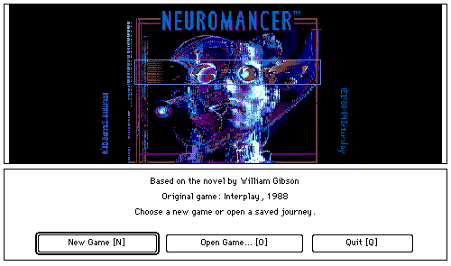
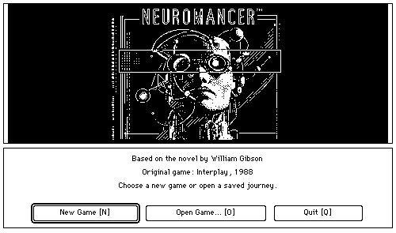
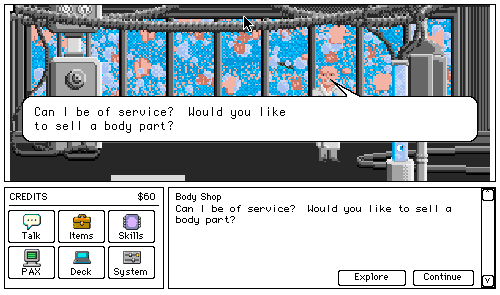
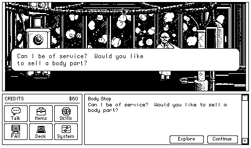
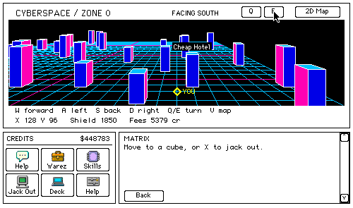
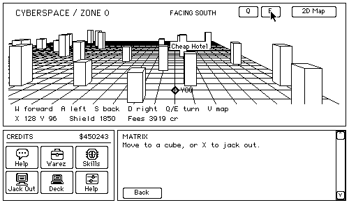
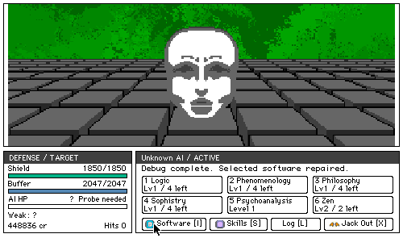
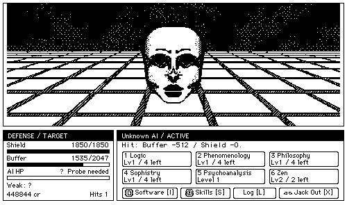

# Neuromancer for 68K Macintosh

 

**Chiba City, on a classic Mac.**

A native 68K Macintosh adaptation of *Neuromancer*, based on the Apple IIGS game. Explore the city, follow conversations and clues, connect to databases, and confront ICE and AI in cyberspace—with a Macintosh interface designed for a 512 × 342 screen.

**v0.0.2 · Monochrome & Color**

[Downloads / Releases](https://github.com/apple2forever/neuromancer-mac68k/releases) · [한국어](README.ko.md) · [Report an issue](https://github.com/apple2forever/neuromancer-mac68k/issues)

| Color | Monochrome |
| :---: | :---: |
|  |  |
| Apple IIGS color artwork | Dedicated 1-bit artwork |

## Two editions, one journey

- **Color:** original Apple IIGS scene artwork, displayed with Color QuickDraw.
- **Monochrome:** separately redrawn black-and-white scenes using solid shapes, dots and hatching. The artwork is not a runtime-dithered version of the color images.
- **Macintosh controls:** clickable icons with a pressed state, directional exit cursors, speech bubbles, and standard file menus and dialogs.
- **Cyberspace:** perspective 3D navigation, an optional 2D map, and dedicated ICE / AI combat controls.
- **Progress:** New Game, Open, Save and Save As, with confirmation before discarding unsaved progress.

The implemented campaign runs from Chatsubo to the final encounter and ending. The adaptation is still being refined; reports of bugs and differences from the original are welcome.

## Screenshots

Actual emulator captures. Screenshots show the game content at its native pixel dimensions; desktop borders have been cropped. Click an image to view it separately.

| | Color | Monochrome |
| :--- | :---: | :---: |
| **Conversations** |  |  |
| **Cyberspace** |  |  |
| **AI combat** |  |  |

## Download and play

Get the disk images from [GitHub Releases](https://github.com/apple2forever/neuromancer-mac68k/releases).

| Edition | Release asset |
| :--- | :--- |
| Color | `Neuromancer-v0.0.2-Color.dsk` |
| Monochrome | `Neuromancer-v0.0.2-Monochrome.dsk` |

1. Boot your Macintosh or emulator into a compatible System 6 or System 7 installation.
2. Mount the appropriate DSK image. Each is a **1.44 MB HFS installation image**, containing the game application only.
3. Copy the application to your Mac hard disk using the Finder, then launch **Neuromancer**.
4. Choose **New Game**, or **Open Game…** to continue an existing save. Save to a writable Mac volume.

The images are **not boot disks**. Mac system software, ROMs and save files are not included. Copying inside the classic Mac Finder preserves the application's resource fork. Image-mounting support depends on your emulator.

## Tested configurations

| Edition | Macintosh / RAM | System | Emulator |
| :--- | :--- | :--- | :--- |
| Monochrome | Macintosh Plus / 4 MB | 6.0.8 | PCE |
| Color | Macintosh IIx / 8 MB | 6.0.8 | MAME |
| Color | Macintosh LC III / 8 MB | 7.1.1 | MAME |

These are tested configurations, not a guarantee for every Mac or emulator. The color edition needs **Color QuickDraw**. The interface is designed for **512 × 342**; the game content inside its window is 500 × 295.

For System 7 / MultiFinder, keep the app's memory settings at **1,536 KB minimum / 2,048 KB preferred**. These are application memory settings, not the total RAM required by the Mac.

## Controls

| Action | Control |
| :--- | :--- |
| Move around the city | Hover over a reachable scene edge for an arrow cursor, then click. `W A S D` / arrow keys also work. |
| Talk / continue | Click **Talk** or press `T`. Click an open speech bubble or press `Return` to continue. Some NPCs speak automatically on arrival. |
| Choose a reply | `Space` cycles thoughts; `Return` says the selected reply. Number keys select a reply directly. Choice changes and confirmation have short sound cues. |
| Move in 3D cyberspace | `W A S D`: forward / left / back / right, relative to your facing. `Q / E`: turn. `V`: switch to the 2D map. |
| Fight ICE / AI | Click an action or press `1–6` to execute it. `I`: software. `S`: skills. `L`: combat log. |
| Save / open / quit | `Command-S` / `Command-O` / `Command-Q`. `Shift-Command-S`: Save As. |
| Full help | **Help → Controls…**, or `Command-H`. |

## Credits

Original game: **Interplay, 1988**, based on the novel by **William Gibson**. The Macintosh adaptation is built with **Retro68**.

This is an unofficial fan project, not an official release by the original creators. This repository contains the project introduction and screenshots; playable builds are distributed through Releases.
